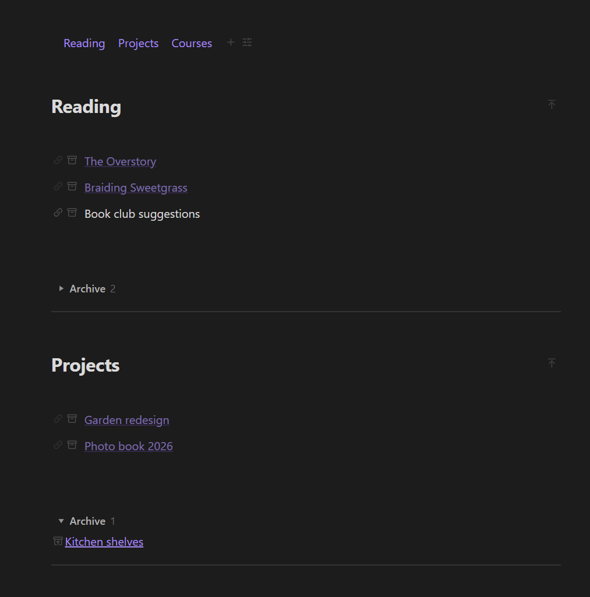

# Section Blocks

**Turn a "home" or index note into a clean dashboard of sections, and keep the pages and images it links to filed away automatically.**



## Is this for you?

- You have one main note, such as Home, Projects or Reading, with lists of links that keep growing.
- Finished items clutter the list, but you don't want to delete them.
- New pages end up dumped in the vault root, and images land in one giant attachments folder.
- Moving a note means its images get left behind.

## What you get

**Sections**

- **Create section** adds a heading with link rows underneath and a folded **Archive** at the bottom.
- Hover a row: 🔗 turns plain text into a new linked page; 🗄 moves the row into the archive (and back).
- A **section index** at the top lists every section as a clickable chip. Hide the ones you don't need.

**Automatic filing**

- **Organize section pages of this note**: each page a section links to moves into `<Pages root>/<Section title>/`.
- **Organize media**: each note's images and videos live in a `<note name> media` folder right next to the note, and links are updated for you. Run it for one note or the whole vault.
- With **Organize media** turned on, anything you paste or drop into a note goes straight into that note's media folder.

## Quick start

1. Open your index note and run **Create section**. Type a title.
2. Add one item per line. Click 🔗 on a plain-text row to create the page.
3. Done with something? Click 🗄 to archive it.
4. Optional: run **Insert index at top** for the clickable section list.

## Plain Markdown

```markdown
# Reading
[[The Overstory]]
Book club suggestions

%% sb-archive {"open":false} %%
[[Atomic Habits]]
%% /sb-archive %%
```

Without the plugin you just see a heading and links.

## Works on

Windows, macOS, Linux, iPhone / iPad and Android. Folder names are built with characters that are valid on every system, so a synced vault stays consistent everywhere.

## Good to know

- The organize commands **move files and rewrite links**. Back up your vault (or use Obsidian Sync / git history) before the first **Organize media of every note**.
- Interface in English and Chinese: follows Obsidian's language by default, or pick one under the plugin's **Language** setting.
- To organize media for the whole vault the plugin lists all files in it. It only works inside your vault and nothing is sent anywhere.
- Works on its own. With [Paipa Gallery](https://github.com/Paipa03/obsidian-paipa-gallery), files dropped into a gallery follow the same `<note> media` rule; with [Editor Enhancer](https://github.com/Paipa03/obsidian-editor-enhancer), sections join its block menu.

## Install

**Settings → Community plugins → Browse**, search **Section Blocks**, then Install and Enable.

## License

MIT
